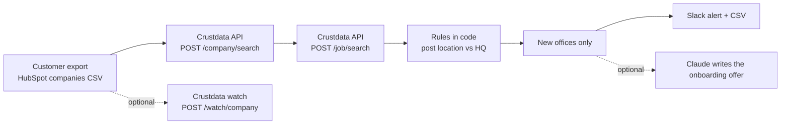

# Customer Office Radar (Open Source, Slack Alerts for CS and Account Managers)

**An open-source Python tool that spots customer expansion signals: it reads your customer list, compares each account's new job post locations with its headquarters, and flags the cities and countries where a customer is opening a new office.**

A new office means a new team that has to be set up on your product. Most teams hear about it months later, after that team has picked its own tools. This tool checks recent job posts for every account, groups them by place, and posts the offices worth an onboarding offer to Slack, with the account owner next to each one. [Crustdata](https://crustdata.com) is the company and job data layer ([API docs](https://docs.crustdata.com)).


## How it works



1. **Resolve accounts.** `POST /company/search` looks up each customer domain and returns its headquarters, city and listed office addresses.
2. **Read job posts.** `POST /job/search` returns posts added since `--since-days`, per account, with the HQ city excluded in the query.
3. **Compare locations.** The rules below run in code, and each has a unit test:
   - remote posts are not an office
   - a post in the HQ city is not a new office
   - a post in the HQ country with no city is too vague to place
   - fewer than `--min-posts` posts in one place (default 2) is noise
   - a city already listed in the company's office addresses is a known office (kept with `--include-known`)
   - `USA` and `United States` count as the same country
4. **Alert.** New places only (`.state/seen.json`), to Slack and `out/offices.csv`, with the account owner from your export.
5. **Optional watcher.** `--create-watch` registers a daily `POST /watch/company` watch that fires when a customer's headquarters or country changes.

## Quickstart

Requires Python 3.9+. No dependencies for the core tool.

```bash
git clone https://github.com/mhimed-crustdata/customer-office-radar
cd customer-office-radar
make setup        # creates .env, then add your CRUSTDATA_API_KEY
make demo         # never posts to Slack
make run          # posts new offices to SLACK_WEBHOOK_URL
make test         # unit tests, no network
```

Export your customers from HubSpot (Companies, Export) and point `CUSTOMERS_CSV` at the file. It needs a `Company domain name` column; `Company name` and `Company owner` are used when present. See `examples/customers.example.csv`.

Run it every morning with cron (`0 8 * * * cd /path/to/repo && make run`) or a scheduled CI job with your keys stored as secrets.

## Configuration

| Variable | Default | What it does |
|---|---|---|
| `CRUSTDATA_API_KEY` | required | Your Crustdata API key. Read from the environment only |
| `CUSTOMERS_CSV` | `examples/customers.example.csv` | Your customer export |
| `SINCE_DAYS` | `30` | How far back to read job posts |
| `MIN_POSTS` | `2` | Posts in one place before it counts as an office |
| `SLACK_WEBHOOK_URL` | empty | Slack incoming webhook. Empty means no Slack post |
| `ANTHROPIC_API_KEY` | empty | Optional Claude step (`--offers`) |
| `ANTHROPIC_MODEL` | `claude-opus-5-5` | Model for the optional Claude step |

Output files in `out/` contain your account data and are git-ignored.

## Example output

A real run on 2026-11-06 against the live API: 20 well-known software companies as the customer list, posts since 2026-10-07, `--min-posts 2`, up to 300 posts read per batch of 10 accounts. Aggregated from `out/offices.json`:

```json
{
  "accounts_checked": 20,
  "accounts_resolved": 18,
  "job_posts_outside_hq_city": 600,
  "clusters_with_2_plus_posts": 65,
  "dropped_as_known_office": 26,
  "office_signals": 39,
  "accounts_with_signal": 9,
  "by_kind": {"new country": 31, "new city": 8},
  "by_post_count": {"2": 13, "3": 6, "4": 5, "5+": 15}
}
```

Read it as a shortlist, not a verdict. Large companies already operate in many countries, so the `new country` count includes offices that exist but are missing from the company's listed addresses; the best signals are small clusters at accounts where you have no seats in that place yet. Company headquarters data is not perfect for every account, so spot-check a flagged place before you send the offer.

What the Slack alert looks like (redacted):

```text
:office: 39 possible new customer office(s) since 2026-10-07
• *[Company]* hiring in *[City]* (new country, HQ [HQ city, state, country]): 5 posts, latest [YYYY-MM-DD] · owner: [owner] <https://example.com/job|job>
   _Offer:_ [two-sentence onboarding offer, when --offers is on]
```

## How to build a customer expansion signals agent

1. **Define the signal as data.** A new office is a cluster of posts in a place that is not the HQ and not an office you already know.
2. **Choose the documented Crustdata calls.** `POST /company/search` for the HQ, `POST /job/search` for the posts, `POST /watch/company` for HQ moves.
3. **Write the rules in code, not in a prompt.** Remote posts, HQ-city posts and one-off posts are filtered by tests, not by a model's judgment.
4. **Only alert on what's new.** State is keyed by account and place, so one office is one alert.
5. **Use the model for the words, not the list.** Claude drafts the onboarding offer; the list comes from the rules.
6. **Push it where people work.** Slack to the account owner, CSV for the CRM. For real time, see Crustdata watch endpoints in the [docs](https://docs.crustdata.com).

## FAQ

**How do I find customer expansion signals?**
Watch the locations of your customers' new job posts. When an account posts several roles in a city or country that is not its headquarters, a new team is forming there, and this tool lists those places per account.

**How does it avoid noise?**
It drops remote posts, HQ-city posts, places with a single post and cities already listed as offices, and it re-checks every rule in code on each post. Raise `--min-posts` for a stricter list.

**Does it contact anyone?**
No. It only posts to your own Slack webhook when `SLACK_WEBHOOK_URL` is set and `--dry-run` is off.

**Is Claude required?**
No. It is optional and off unless `ANTHROPIC_API_KEY` is set and you pass `--offers`.

**Which Crustdata endpoints does it use?**
`POST /company/search`, `POST /job/search` and, with `--create-watch`, `POST /watch/company`, on API version `2025-11-01`. See the [Crustdata API docs](https://docs.crustdata.com).

## Project layout

```text
office_radar.py     # the workflow
crustdata_api.py    # tiny Crustdata client (stdlib only)
notify.py           # optional Slack + Claude
examples/           # example customer CSV
tests/              # unit tests, no network
```

## License

MIT. See [LICENSE](LICENSE). Data layer: [Crustdata](https://crustdata.com) ([docs](https://docs.crustdata.com)).
